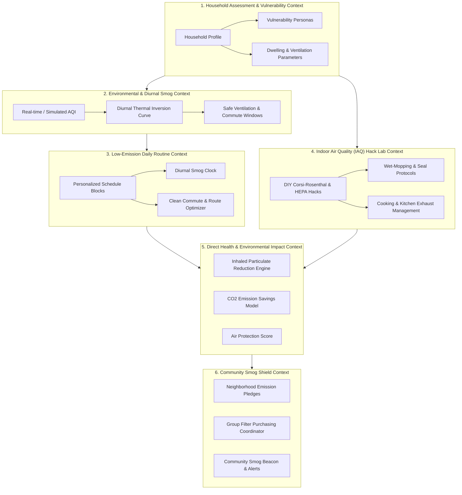

# Respiro Domain Model & Ubiquitous Language

This document defines the core domain model, ubiquitous language, bounded contexts, mathematical invariants, and state transitions for **Respiro**. All contributors and Google Antigravity 2.0 specialized agents must adhere strictly to these domain concepts.

---

## 1. Domain Overview & Bounded Contexts

Respiro is an intelligent clean-air copilot engineered to help families and urban communities navigate severe winter smog and chronic particulate air pollution ($PM_{2.5}$, $PM_{10}$, $NO_2$).

The system decomposes into six primary Bounded Contexts:

---

## 2. Ubiquitous Language (Glossary)

### Household Profile (`HouseholdProfile`)

The root entity representing a family or living unit:

- `city`: Geographical locality (e.g., "Delhi-NCR", "Patna", "Lahore", "Beijing", "Mumbai").
- `dwellingType`: Architectural containment tier:
  - `apartment_high_rise`: Lower road-level dust; elevated particulate drift; tight seals.
  - `ground_floor_independent`: High ground-level dust infiltration and traffic emission exposure.
  - `ventilated_house`: High natural air changes per hour ($ACH$); requires active sealing.
- `vulnerabilities`: Vulnerable cohorts present: `infants`, `elderly`, `asthmatics_respiratory`, `cardiovascular`, `outdoor_commuters`, `pets`.
- `purifierSetup`: Existing clean air infrastructure: `none`, `diy_filters`, `single_room_hepa`, `whole_home`.
- `commuteMode`: Primary transport mode: `metro_ev`, `two_wheeler_unprotected`, `car_sealed`, `bus_public`, `walk_cycle`.

### Diurnal Thermal Inversion Curve (`InversionCurve`)

The 24-hour mathematical curve describing seasonal winter smog trapping:

- **Peak Inversion Trap (05:00 - 09:30):** Ground cooling traps stagnant particulate layer at breath height. Hazardous outdoor exposure; zero natural ventilation.
- **Atmospheric Boundary Dispersion Window (12:00 - 15:30):** Solar surface heating lifts inversion layer, ambient air disperses. **Optimal daily window for rapid cross-ventilation and outdoor transit**.
- **Secondary Evening Compression (18:30 - 23:00):** Post-sunset radiative cooling re-traps evening vehicular emissions and biomass burning.

### Indoor Air Quality Hack (`IAQHack`)

A science-backed, low-cost intervention to reduce indoor particulate exposure:

- `corsi_rosenthal_box`: 4-5 MERV-13 filters paired with an axial box fan delivering high Clean Air Delivery Rate (CADR > $350\text{ m}^3/\text{h}$) at 1/5th commercial purifier cost.
- `wet_mopping_protocol`: Replacing dry sweeping (which re-suspends settled $PM_{10}$ particles) with electrostatic damp microfiber mopping.
- `positive_pressure_seal`: Sealing drafty window frames with foam/weatherstripping while directing a single filtered intake inwards.
- `kitchen_containment`: Utilizing high-exhaust cross-drafts during frying/spicing, preventing volatile particulate spread through bedrooms.
- `botanical_filtration`: Strategic placement of high-leaf surface plants (Snake Plant, Areca Palm, Peace Lily) for microclimate humidity and particulate settling.

### Smart Daily Routine (`DailyRoutine`)

Time-phased daily protocol generated to minimize pollution inhalation and household carbon emissions:

- `timeSlot`: Time block (e.g. `07:00 - 08:30`).
- `activity`: Designated routine task (e.g., "Filtered Indoor Yoga", "Off-Peak Metro Commute", "Rapid 15-Minute Flush Ventilation").
- `airSafetyTier`: Exposure risk tier: `safe`, `caution`, `hazardous`.
- `indoorPurifierSetting`: Air cleaner operation speed: `off`, `eco_silent`, `boost_clean`.
- `maskRecommendation`: Respiratory PPE recommendation: `none`, `surgical_dust`, `n95_ffp2`.

### Direct Impact Ledger (`ImpactLedger`)

Deterministic calculations quantifying the real-world benefit of user actions:

- `pm25InhaledAvoidedUg`: Micrograms of $PM_{2.5}$ particles prevented from depositing in deep alveolar lungs:
  $$\Delta \text{Mass} = \text{TidalVolume} \times \text{BreathingRate} \times \Delta \text{Concentration} \times \text{Duration}$$
- `cigaretteEquivalentsAvoided`: Epidemiological equivalence (approx. $22\,\mu\text{g/m}^3$ daily $PM_{2.5}$ exposure $\approx 1$ cigarette).
- `carbonSavedKg`: Estimated $CO_2$ equivalent emissions prevented by shifting transit or heating habits.
- `airProtectionScore`: 0–100 index representing household defense effectiveness.

### Community Smog Shield (`CommunitySmogShield`)

Neighborhood-scale collective resilience features:

- `neighborhoodZone`: Micro-locality cluster (e.g., "Rohini Sector 9", "Indirapuram", "Koramangala").
- `collectivePledge`: Collective agreement to prevent trash burning, carpool for school runs, and turn off diesel gensets.
- `filterBulkOrder`: Coordinated community purchasing of bulk MERV-13/HEPA sheets to reduce costs for underprivileged neighbors.

---

## 3. Strict Domain Invariants

1. **Deterministic Calculations in Code (ADR 1):** Inhaled particulate mass, CADR calculations, inversion curves, and carbon savings must be calculated using pure TypeScript functions in `lib/air-quality.ts` and `lib/impact.ts`. Never calculate metrics via LLM output.
2. **High Availability Fallback (ADR 2):** When cloud inference is unavailable or rate limited, the deterministic offline engine generates equivalent structured routines and hacks with zero user interruption.
3. **No Unsafe Advice Invariant:** Never advise cross-ventilation during peak morning thermal inversion (05:00 - 09:30) or when outdoor AQI exceeds 400.
4. **Vulnerability Gating:** If asthmatic or infant profiles are present, high-risk outdoor activities are strictly marked `prohibited`, and N95 protection is mandatory for transit.
5. **Multi-Tenant Ownership:** Every profile, routine, hack completion, and community pledge is validated server-side and owner-isolated (`requireUserId`, `requireOwned`).
